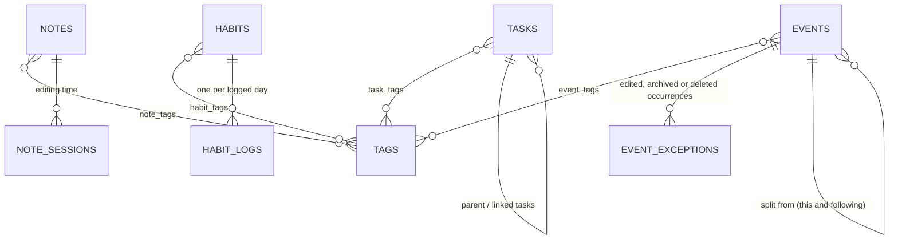

# kanso-backend

The API behind [kanso](https://kanso-web-app.vercel.app), a productivity app for tasks, notes, habits, calendar events and a daily debrief. It's built with FastAPI, SQLAlchemy 2, Alembic and Postgres (hosted on Supabase), and deployed on Fly.io.

| Repository | Role |
|---|---|
| [kanso-frontend](https://github.com/LuisFVillalon/kanso-frontend) | Next.js web app (start here for the full architecture) |
| **kanso-backend** (this repo) | Data API: tasks, tags, notes, habits, events, mood check-ins, profile, daily debrief, notifications, Canvas LMS connection, demo sandboxes |
| [kanso-ai](https://github.com/LuisFVillalon/kanso-ai) | LLM-backed learning-resource recommendations |

Interactive API reference: `/docs` on any running instance.

## Highlights

- **Auth without owning passwords.** Users sign in with Supabase Auth; every endpoint verifies the Supabase JWT (ES256/RS256 via the project's JWKS, or HS256 with the project secret) and takes the user id from the token's `sub` claim. No endpoint accepts a user id from the client.
- **Tenant isolation.** Every row carries a `user_id` and every query filters on it. Single-row lookups all go through one helper, `crud/base.py:get_owned`, so the ownership check can't be skipped in a new module.
- **Database closed to direct access.** Supabase exposes `public` tables through an auto-generated REST API. A migration enables Row Level Security and revokes the `anon`/`authenticated` grants on every table (including future ones), so the public Supabase key can't reach the data. The backend connects as the table owner and is unaffected.
- **Per-visitor demo sandboxes.** `POST /demo/seed` accepts only Supabase *anonymous* users and fills their sandbox with sample data dated relative to the visitor's local day. A background task deletes sandboxes older than a day, both their rows and their auth users.
- **Timezone-correct logic.** The server runs in UTC. Habit streaks, "due today" and the daily debrief take the caller's `local_date`/`local_time` rather than the server clock, and note time totals take the caller's UTC offset.
- **A rule-based daily debrief.** `GET /daily-debrief` combines overdue and due-today tasks, today's completions and events, habit status and workload capacity (committed vs. available minutes, after events and respecting rest days) into a prioritized "focus next" list. No LLM is involved.
- **Third-party tokens encrypted at rest.** A user's Canvas access token or calendar feed link is stored only as AES-256-GCM ciphertext, with the key in a Fly secret rather than the database, and is never sent back to the browser or logged.
- **Input bounds and rate limits.** Request schemas cap field lengths and list sizes; demo seeding, Canvas connect/test and Canvas data fetches are rate-limited per user.

## Data model



Every table also carries `user_id`. The single-row-per-user tables are `profiles` (display name and synced UI preferences), `calendar_settings` (the current term tracker), `drawings` (the doodle canvas), `notification_preferences` and `canvas_connections` (the encrypted Canvas token or calendar feed link); `notification_states` holds read and dismissed state per notification, `mood_checkins` holds one mood check-in per day, week or month, `archived_terms` holds the past term trackers a user archived, and `term_rollovers` holds each user's queued next term and auto-archive setting. Join tables and child rows cascade on delete, so removing an account is one pass over `crud/account_crud.py:USER_OWNED_MODELS`.

## Project structure

```
app/
  main.py        # App, CORS, router registration, /health
  core/          # auth.py (JWT verification), supabase_admin.py, rate_limit.py, http_utils.py,
                 # crypto.py (token encryption), canvas_client.py (Canvas API calls),
                 # canvas_feed.py (Canvas calendar feeds), canvas_cache.py (in-process cache of Canvas data)
  routers/       # One per domain; thin handlers that depend on get_current_user + get_db
  crud/          # Queries and business logic (streaks, debrief, demo seed, account deletion)
  models/        # SQLAlchemy models
  schemas/       # Pydantic request/response models; limits.py holds the input bounds
  database/      # Engine and session setup (Supabase pooler / pgBouncer-safe)
tests/           # pytest suite (needs a throwaway Postgres, see below)
alembic/         # Migrations (date-prefixed); run automatically on every deploy
```

Routes use verb-style paths (`/get-tasks`, `/create-task`, `/update-task/{id}`, `/del-task/{id}`), except the Canvas ones, which are one resource under `/canvas` with HTTP methods. Each domain has one file per layer: `routers/` → `crud/` → `models/` + `schemas/`.

## Endpoints

All endpoints require `Authorization: Bearer <supabase-jwt>`.

| Area | Endpoints |
|---|---|
| Tasks | `GET /get-tasks` · `POST /create-task` · `PUT /update-task/{id}` · `PUT /update-linked-tasks/{id}` · `PATCH /update-task-status/{id}` · `PATCH /archive-task/{id}` · `PATCH /unarchive-task/{id}` · `DELETE /del-task/{id}` · `PATCH /restore-task/{id}` · `DELETE /purge-task/{id}` |
| Tags | `GET /get-tags` · `POST /create-tags` · `PUT /update-tag/{id}` · `PATCH /archive-tag/{id}` · `PATCH /unarchive-tag/{id}` · `DELETE /del-tag/{id}` · `PATCH /restore-tag/{id}` · `DELETE /purge-tag/{id}` |
| Notes | `GET /get-notes` · `POST /create-note` · `PUT /update-note/{id}` · `PATCH /archive-note/{id}` · `PATCH /unarchive-note/{id}` · `DELETE /del-note/{id}` · `PATCH /restore-note/{id}` · `DELETE /purge-note/{id}` |
| Note time | `POST /note-session/start` · `PUT /note-session/end/{id}` · `GET /note-session/total/{note_id}` · `GET /note-session/totals` · `GET /note-session/totals-range` · `POST /note-session/reap` |
| Habits | `GET /get-habits` · `POST /create-habit` · `PUT /update-habit/{id}` · `PATCH /archive-habit/{id}` · `PATCH /unarchive-habit/{id}` · `DELETE /del-habit/{id}` · `PATCH /restore-habit/{id}` · `DELETE /purge-habit/{id}` · `PATCH /toggle-habit/{id}` · `PATCH /toggle-habit-date/{id}` · `POST /verify-streaks` · `GET /habit-history/{id}` |
| Trash | `GET /get-trash` |
| Mood check-ins | `GET /get-mood-checkins?start_date=&end_date=&kinds=` · `PUT /save-mood-checkin` · `DELETE /del-mood-checkin/{id}` · `GET /get-mood-tags` |
| Daily debrief | `GET /daily-debrief?local_date=&local_time=&tz=` |
| Calendar activity | `GET /get-calendar-activity?start_date=&end_date=&tz=&include_archived=` |
| Events | `GET /get-events?archived=` · `GET /get-event/{id}` · `GET /get-archived-event-occurrences?tz=` · `GET /get-event-report?start_date=&end_date=&tz=` · `POST /create-event` · `PUT /update-event/{id}?scope=&occurrence_date=` · `PATCH /archive-event/{id}?scope=&occurrence_date=` · `PATCH /unarchive-event/{id}?scope=&occurrence_date=` · `DELETE /del-event/{id}?scope=&occurrence_date=` · `PATCH /restore-event/{id}?occurrence_date=` · `DELETE /purge-event/{id}?occurrence_date=` |
| Notifications | `GET /get-notifications?tz=` · `POST /mark-notifications-read` · `POST /mark-all-notifications-read?tz=` · `POST /dismiss-notifications` · `GET /get-notification-preferences` · `PATCH /update-notification-preferences` |
| Profile & settings | `GET /get-profile` · `POST /save-profile` · `GET /get-calendar-settings?local_date=` · `PATCH /update-calendar-settings` |
| Archived terms | `GET /get-archived-terms?local_date=` · `POST /archive-term` · `DELETE /del-archived-term/{id}` |
| Term rollover | `GET /get-term-rollover?local_date=` · `PATCH /update-term-rollover` · `PUT /save-next-term?local_date=` · `DELETE /del-next-term` · `POST /archive-ended-term` · `DELETE /del-ended-term` |
| Doodle canvas | `GET /get-drawing` · `POST /save-drawing` · `DELETE /delete-drawing` |
| Canvas connection | `GET /canvas/connection` · `PUT /canvas/connection` · `PUT /canvas/connection/feed` · `POST /canvas/connection/test` · `PATCH /canvas/connection` · `DELETE /canvas/connection` (not for demo sandboxes) |
| Canvas data | `GET /canvas/overview?tz=&range=` · `GET /canvas/classes?tz=&include_hidden=` · `GET /canvas/courses?include_hidden=` · `GET /canvas/courses/{id}/modules` · `GET /canvas/courses/{id}/assignments` · `GET /canvas/announcements?tz=` (all take `refresh=`; sample data for demo sandboxes) |
| Canvas linked tasks | `POST /canvas/linked-tasks/sync?tz=&refresh=` (sample data for demo sandboxes) |
| Canvas class tags | `GET /canvas/course-tags` · `PUT /canvas/course-tags/{course_id}` |
| Account | `POST /update-password` (email accounts only; needs the current password) · `DELETE /delete-account` |
| Demo | `POST /demo/seed?local_date=` (anonymous users only) |

**Linked tasks.** A task can have linked tasks: tasks that lead up to completing it, stored as subtasks (`parent_task_id`). Each task has at most one parent, and links nest to any depth: a linked task is a full task (tags, due date and time, estimate, reminder, description, Canvas link and the rest) and can have linked tasks of its own, and a task moved under another parent takes its own linked tasks along. Links that would form a loop (a task under itself or under any task below it) or put a task under an archived parent are rejected. Every way of setting a parent (`POST /create-task`, `PUT /update-task/{id}` and the endpoint below) answers these with a 400. Only new links are checked: `PUT /update-task/{id}` checks only a changed parent and the endpoint below only tasks not already under this parent, so re-saving existing links always works. Every task response carries `parent_task`, `{"id", "title"}` of the task directly above it (`null` for top-level tasks), so a client can show the parent even when it isn't in the same list, such as an archived subtask's active parent; `GET /get-calendar-activity` tasks carry it too. Linked tasks carry a `position` (`null` for top-level tasks) and belong under their parent in order of `position`, then `id`; a task created or moved under a parent goes last, and links made before ordering existed have a `null` position and sort after the rest.

`PUT /update-linked-tasks/{id}` saves all of a task's linked tasks in one transaction. The body lists them in order, up to 100, each either an existing task by its `id` or a new task: `{"children": [{"id": 12}, {"title": "Draft cover letter", "due_date": "2026-11-03", "priority": 2}]}`. Existing tasks are linked, and moved here if they had another parent, but never edited: any other field sent with an `id` is ignored. A new task takes any of the fields `POST /create-task` does (`title`, which is required, `description`, `category`, `completed`, `priority`, `due_date`, `due_time`, `estimated_time`, `reminder_minutes`, `tags` and the Canvas link fields), with the same limits (422) and checks: a priority or Canvas assignment already held by another active or open task, including another new task earlier in the list, is a 400 or 409 as there. Without `tags` it gets the parent's tags; with `tags`, even `[]`, it gets those instead. Its `parent_task_id` may be left out or set to this task's id; any other value is a 400. A title-only entry creates a task with the parent's tags and no due date or priority, as before. Each gets its index as its `position`. Active linked tasks left out are unlinked, not deleted; archived ones stay linked, since the client doesn't see them. Listing an archived, deleted or missing task, or the same task twice, is a 400; any error saves nothing. The response is `{"parent": Task, "children": [Task, ...]}`, children in order.

`DELETE /del-task/{id}` and `PATCH /archive-task/{id}` take `?linked=keep|cascade`, for the "delete or archive its linked tasks too?" question. `cascade`, the default (so clients that don't send it work as before), deletes or archives the task's subtasks along with it, as described under Archiving and Trash below. `keep` first unlinks the task's linked tasks, which stay as standalone top-level tasks (`parent_task_id` and `position` set to `null`) with their own linked tasks still under them, then deletes or archives the task alone: deleting unlinks every linked task not in the trash, archived ones included; archiving unlinks the active ones and leaves those archived on their own linked. An unlinked task doesn't come back under the parent when the parent is restored. Any other value is a 422.

`PATCH /update-task-status/{id}?with_linked=true` is "Complete all": when the toggle completes the task, its open linked tasks at every depth that aren't archived or deleted are completed in the same transaction, with the same `completed_date`. Reopening a task with it leaves the linked tasks as they are. Without it (the default) only the task itself is toggled.

**Archiving.** Tasks, notes, tags and habits carry an `archived_at` timestamp (`null` while active). `GET /get-tasks`, `/get-notes`, `/get-tags` and `/get-habits` return active rows only; pass `?archived=true` to list the archived ones instead. Archiving a task also archives its subtasks at every depth (unless `?linked=keep`), and restoring it restores the subtasks archived with it plus any archived parents above it. Archiving a tag only hides it: tasks, notes, habits and events keep it in their `tags` lists. Creating or updating a task, note or event with an archived tag it didn't already carry restores that tag. Archived tasks, notes and habits are left out of the daily debrief and note-time totals, and archived habits are skipped by `POST /verify-streaks`.

**Trash.** The `del-*` endpoints move a task, note, tag, habit or event to the trash by setting its `deleted_at` instead of removing the row, and work on archived rows too. A deleted item is gone from every list, lookup, count and the debrief, but its tag links, habit logs and note sessions are kept: `PATCH /restore-{kind}/{id}` brings it back intact (into the archive, if it was archived). Deleting a task also deletes its subtasks at every depth (unless `?linked=keep`); restoring it restores the subtasks deleted with it plus any deleted parents above it, and purging it purges the subtasks deleted with it, leaving any deleted on their own in the trash as top-level tasks. A restored task comes back under its old parent wherever that parent now sits; one whose old parent is gone for good comes back as a top-level task instead. A deleted tag is hidden from the `tags` lists of the items carrying it until restored, and naming it on a task, note, habit or event restores it. `GET /get-trash` lists deleted items newest first, each with its `purge_at`, 30 days after deletion; a deleted task also carries its `parent_task_id` and `parent_task` (`{id, title}`, `null` for a top-level task and for other kinds), whether that parent is live or in the trash too. `DELETE /purge-{kind}/{id}` deletes one for good right away. Items deleted more than 30 days ago are treated as gone everywhere, the trash and restore included, and are permanently deleted, for every user at once, when the app starts and whenever anyone opens the trash, restores or purges from it, or deletes something (`crud/trash_crud.py`), so no scheduler is needed.

**Calendar activity.** `GET /get-calendar-activity` returns what the user planned and did across a range of their local days (up to 366): tasks due in the range, tasks completed in it (by `completed_date`, set when a task is marked complete and cleared when it's reopened), closed note editing sessions that overlap it, and habit completions, plus `notes` and `habits`: the notes behind those sessions and the habits behind those completions, each with its `tags` (deleted tags left out), so a client can total time per tag. It backs the calendar's week view and its weekly, monthly and yearly reports. Completion and session timestamps come back in UTC with a `Z` suffix; `tz`, the caller's IANA time zone (e.g. `America/Los_Angeles`, from `Intl.DateTimeFormat().resolvedOptions().timeZone`), matches them against the caller's local days, correctly across DST changes; an unknown zone is a 422. Deleted (trashed) tasks, notes and habits are always left out. Archived ones are left out too unless `include_archived=true`, meant for the reports so archived work still counts. It adds archived tasks (due and completed), the sessions of archived notes and the logs of archived habits. Tasks completed before completion times were recorded have no `completed_date`, so they don't appear as completions. `events` lists the event occurrences on those days (see Events below); `include_archived` doesn't change them.

**Events.** Calendar events, like Google Calendar's. An event is a series (`events`): a one-off event, or one that repeats weekly on chosen weekdays every N weeks. `POST /create-event` takes `title` (required), `description`, `tags` (several, by name, like tasks), `all_day`, `start_date`, `end_date` (the last day it can repeat on; `null` repeats forever), `start_time` and `end_time` (local `"HH:MM"`, required unless `all_day`; an end before the start runs past midnight into the next day, an end equal to the start is a 422), `time_zone` (the browser's IANA zone, else 422), `repeat_days` (weekdays, 0 = Sunday to 6 = Saturday as in `rest_days`; empty for a one-off event, which ignores `end_date`), `repeat_interval` (every 1 to 52 weeks, counted in Sunday-to-Saturday weeks from the week of `start_date`; 2 is biweekly) and `reminder_minutes` (0 to 10080 before each occurrence, or `null` for no reminder). Times are wall-clock times in the series' own zone, so a 10:00 class stays at 10:00 across DST; a time a DST change skips moves to the matching instant after it (02:30 becomes 03:30). Events and their responses carry `id`, the fields above, `split_from_id`, `created_date`, `archived_at` and `deleted_at`. `GET /get-events` lists active series (`?archived=true` the archived ones) and `GET /get-event/{id}` returns one.

Occurrences are expanded on read, never stored. Calendars get them as `events` from `GET /get-calendar-activity?start_date=&end_date=&tz=` (up to 366 days): those on the caller's local days, in start order, each with `event_id`, `occurrence_date` (the day the rule puts it on, in the series' zone; it identifies the occurrence), `title`, `description`, `tags`, `all_day`, `date`, `end_date`, `start_time` and `end_time` (where it falls in `tz`; `end_date` is the next day for one past midnight, which counts on both days; an all-day event keeps its own day in every zone, with `null` times), `starts_at`/`ends_at` (UTC), `time_zone`, `repeat_days`, `repeat_interval`, `reminder_minutes`, `edited` (changed on its own), `past` (ended before now) and `archived`. Calendars show past occurrences, archived ones included and flagged, and upcoming ones that aren't archived; deleted ones never. `GET /get-archived-event-occurrences?tz=` lists the occurrences archived on their own (whole archived series are `GET /get-events?archived=true`).

Changing a repeating event takes `scope`: `this` (only the occurrence on `occurrence_date`), `following` (it and every later one) or `all` (the default). `this` and `following` need an `occurrence_date` the rule puts an occurrence on (else 400 or 404). `this` stores the change in an exception row (`event_exceptions`) for that occurrence. `following` splits the series: it now ends the day before, and a new series starting on `occurrence_date`, with `split_from_id` set, takes the later exceptions and the change; from the first occurrence it acts as `all`. `all` changes the series, and occurrences changed on their own keep the fields they changed. A one-off event ignores `scope`. `PUT /update-event/{id}` changes only the fields given and returns the series holding the changed occurrences (for `following`, the new one). With `scope=this` only `title`, `description`, `tags`, `all_day`, `start_time`, `end_time` and `date` (moves the occurrence to another day) apply, and the series fields are a 400; `date` with another scope is a 400 for a repeating event and moves a one-off one. `PATCH /archive-event/{id}` and `PATCH /unarchive-event/{id}` take the same scopes; unarchiving one occurrence clears only its own archive, not its series'. `DELETE /del-event/{id}` moves the series (`all`), the part split off (`following`) or the one occurrence (`this`) to the trash; `GET /get-trash` lists events as kind `event`, a single occurrence with its `occurrence_date` (and its series' `id`), and `PATCH /restore-event/{id}` and `DELETE /purge-event/{id}` act on the occurrence when given that `occurrence_date`. An occurrence purged or past retention stays cancelled, so its series doesn't bring it back.

`GET /get-event-report?start_date=&end_date=&tz=` (up to 366 days) backs Reports → Events. It counts what the calendar shows, and upcoming archived occurrences are left out of every figure. It returns `event_count` (occurrences starting in the range), `archived_count` (the past archived occurrences among them; upcoming archived ones are left out), `total_minutes` (all-day events count but add no minutes), `by_tag` (`{tag, minutes, count}`, largest first; an event counts in full under each of its tags, untagged ones under `tag: null`), `by_day` (`{date, count, minutes, is_rest_day, window_minutes, event_window_minutes, free_minutes}`), `by_week` (Sunday weeks) and `by_month` (`{start, count, minutes}`), `busiest_day`, and the free time events leave in the work windows: `window_minutes` is every day's work window added up (rest days add none; 08:00 to 22:00 for a profile without one), `event_window_minutes` the part of it events took (overlapping events count once), `free_minutes` what's left and `free_pct` its share of `window_minutes`.

The daily debrief takes the caller's `tz` to place today's events (without it each is read in its own zone). It adds `events_today` (as the calendar shows them), `passed_events_today` (the ones ended by `local_time`, archived ones left out), and `event_minutes_by_tag` and `passed_event_minutes_by_tag` for today's and the passed events. Event time inside today's work window comes out of the capacity left for tasks: `workload.window_minutes` is the window, `event_minutes` the part events take (overlaps once; archived and all-day events take none), `available_minutes` what's left, and `free_minutes` that less `committed_minutes`.

**Archived terms.** The term tracker is one current term per user (`calendar_settings`: `title`, `start_date`, `end_date`). Archiving is optional: `POST /archive-term` moves the current term into the user's archived terms, so the month calendar can keep showing it after it ends, and returns it with its new `id` and `archived_at`; with no current term it is a 404. The current term is removed, so `GET /get-calendar-settings` answers 404 until the user sets up a new one with `PATCH /update-calendar-settings` or a queued next term takes over (see Term rollover). A user who never archives keeps their current term exactly as before. `GET /get-archived-terms` lists the user's archived terms, earliest `start_date` first, and `DELETE /del-archived-term/{id}` deletes one for good and returns it (404 if it isn't the user's). Demo sandboxes get one archived term, ending before the current one starts.

**Term rollover.** A user can queue the next term while a current term exists: `PUT /save-next-term` takes `{"title", "start_date", "end_date"}`, queuing it or replacing the queued one. It must start after the current term's `end_date` and end after it starts (else 422), and with no current term it is a 409 (set that up with `PATCH /update-calendar-settings` instead). `DELETE /del-next-term` clears it (404 if none is queued). `PATCH /update-term-rollover` takes `{"auto_archive": bool}`, off by default. `GET /get-term-rollover` returns `{"auto_archive", "next_term", "ended_term"}`, each term `{"title", "start_date", "end_date"}` or `null`. There is no scheduler: `GET /get-calendar-settings`, `GET /get-archived-terms`, `GET /get-term-rollover` and `PUT /save-next-term` roll the tracker over first, against `local_date`, the caller's local `YYYY-MM-DD` (the server's date if missing or malformed). Once the current term has ended (its `end_date` is before `local_date`), auto-archive archives it as `POST /archive-term` does. A queued next term then becomes the current term, as soon as the current term has ended or there is none (e.g. it was archived by hand), even before its `start_date`. With auto-archive off, an ended term the next term replaces is kept as `ended_term`, until `POST /archive-ended-term` archives it (returning the archived term) or `DELETE /del-ended-term` drops it (404 if there is none); only the latest is kept. With auto-archive off and nothing queued, an ended term stays the current term, as before. Rolling over again changes nothing, so concurrent or repeated reads never archive a term twice.

**Notifications.** In-app alerts, computed on demand from tasks, events, mood check-ins and the profile each time `GET /get-notifications?tz=` is called, so there is no scheduler. `tz` is the caller's IANA time zone, as for calendar activity; due times, the day's work window ("Day starts at" and "Call it a day", see the profile's `day_windows` below; default 08:00 to 22:00) and quiet hours are local times in it, and every alert time follows DST. Four types exist:

| Type | Fires | Lapses |
|---|---|---|
| `task_reminder` | `reminder_minutes` before a task's due time (the task's own, else the user's default, 120) | When the task is due |
| `mood_reminder` | `mood_reminder_minutes` (default 60) before "Call it a day", but no earlier than the day start, while the day's mood check-in isn't logged; not on rest days | At midnight, or at "Call it a day" if that is after midnight |
| `mood_missed` | At the day start, listing the past 7 days with no daily mood check-in; not on rest days | At midnight |
| `event_reminder` | An event's `reminder_minutes` before each occurrence starts (none if it is `null`); not for archived or deleted occurrences | When it starts, or when it ends for a reminder at the start |

The earlier `due_today`, `overdue`, `habit_reminder` and `final_warning` types are no longer sent. Users who had only the final warning on (with `task_reminder` switched off) now need to turn `task_reminder` on to get task alerts. The `mood_reminder` switch turns daily mood check-ins on and off as a whole, so with it off `mood_missed` isn't sent either; `mood_missed` also has its own switch. The `mood_reminder` switch replaced the retired `mood_checkins.daily` setting, and a migration carried that over by switching `mood_reminder` off for users who had daily check-ins off. The retired `remind: "off"` setting used to silence both; a migration carried it over by switching both types off for those users. `mood_missed` leaves out rest days and days before the user's first daily check-in (when daily check-ins were switched on isn't stored), and drops days as they are backfilled. Neither says anything about what a check-in holds, only that one is due or missing.

Only open tasks with a `due_date` and `due_time` count. Completed, archived and deleted tasks are left out. Each notification has `id`, `type`, `title`, `body`, `fire_at` (UTC, `Z` suffix), the `task_ids` it is about (`habit_ids` is kept for older clients and is always empty), the `event_ids` an event reminder is about, `dates` (for the mood alerts, the local days whose check-in is due or missing, so the client can open the form for them; for an event reminder, the occurrence's `occurrence_date`) and `read`; the list is newest first. Ids are deterministic, `{type}:{subject}:{occurrence}` (e.g. `task_reminder:task-12:2026-10-20T16:00`, `event_reminder:event-7:2026-10-20T09:00` or `mood_missed:mood:2026-10-20`), so read and dismissed state, stored per id, holds across reloads and devices; moving a task's due time makes a new occurrence. `POST /mark-notifications-read` and `POST /dismiss-notifications` take `{"ids": [...]}` (up to 200), and still accept ids of the retired types; `POST /mark-all-notifications-read?tz=` marks everything currently listed. Dismissed notifications are left out of the list. Occurrences older than 30 days are no longer listed, and their state rows are deleted, for every user, at startup and whenever anyone marks or dismisses notifications.

`GET /get-notification-preferences` returns `types` (every type, `true` unless switched off), `quiet_hours_start`/`quiet_hours_end` (`"HH:MM"` or `null`), `default_reminder_minutes` and `mood_reminder_minutes`. `PATCH /update-notification-preferences` changes only the fields given: `types` merges (the retired types are accepted and ignored), quiet hours are set as a pair (they may run past midnight, e.g. 22:00 to 07:00) and cleared with two `null`s, a `null` `default_reminder_minutes` restores 120, and `mood_reminder_minutes` takes 1 to 1439 (under a day), with `null` restoring 60; a lead reaching back past the day start fires at the day start. An alert that fires during quiet hours is delivered when they end, with its `fire_at` moved to then, and is dropped if it would already have lapsed. Tasks take an optional `reminder_minutes` (1 to 10080) on create and update; `null` uses the default.

**Mood check-ins.** A short end-of-day, end-of-week or end-of-month form about the user's mood, for the calendar reports. There is one check-in per user, `period_kind` (`day`, `week` or `month`) and `period_start`, the caller's local date: the day itself, the Monday of a Mon–Sun week, or the 1st of the month. Every check-in has a `mood` from 1 (Rough) to 5 (Great), an optional `note` (up to 280 characters) and `tags`; the other fields depend on the kind:

| Kind | Fields |
|---|---|
| `day` | `energy` (1 Drained to 5 Charged) · `stress` (1 Calm to 5 Maxed) |
| `week` | `workload` (0 too light, 1 about right, 2 too much) · `highlight` (the best part of the week, up to 120 characters) |
| `month` | `progress` (on what matters, 1 none to 5 a lot) · `word` (the month in one word, up to 24 characters) |

`PUT /save-mood-checkin` creates the period's check-in or replaces it in place (same `id`), so editing and backfilling are the same call; it takes the whole form, so a field left out is cleared. A field from another kind, a week not starting on a Monday, a month not starting on the 1st, or a `period_start` more than a day past the server's UTC date is a 422. `GET /get-mood-checkins` returns the check-ins whose `period_start` falls in a range of up to 366 days, oldest first, optionally only the `kinds` given (comma-separated, e.g. `day,week`). `DELETE /del-mood-checkin/{id}` deletes one for good, with no trash, and returns it so the client's Undo can save it again. Mood tags are a list of their own, separate from task tags: each check-in carries up to 20, trimmed and de-duplicated ignoring case, and `GET /get-mood-tags` returns the default list (`Slept well`, `Exercised`, …) plus the custom tags the user has used, most recent first. Correlations with tasks, note time and habits are left to the frontend, which joins these rows with `/get-calendar-activity`. Mood data stays out of the daily debrief and every AI feature.

The profile's `home_panels` is the set of home-page panels switched on, in Tasks → Notes → Canvas order: `tasks`, `notes`, `canvas`, `tasks,notes`, `tasks,canvas`, `notes,canvas` or `tasks,notes,canvas` (the legacy `canvas,tasks` pair still validates for older saved profiles). It is `null` until set (the frontend's default), `POST /save-profile` rejects any other value with 422, and demo users save it like any other profile preference.

The profile's work window is `day_start_time` and `shutoff_time` (local `"HH:MM"`), with `rest_days` as weekday numbers, 0 (Sunday) to 6 (Saturday). `day_windows` overrides the window per weekday: `{"0".."6": {"start": "HH:MM", "end": "HH:MM"}}`, keyed with the same numbering; a weekday without an entry, or a `null` `day_windows`, uses `day_start_time` and `shutoff_time`. An end at or before its start runs past midnight into the next day, as for the daily window, and an end equal to its start is a 422. `POST /save-profile` replaces the saved windows as a whole. The day's window sets the daily debrief's available minutes (less the time events take in it), the free time in the events report and the mood alerts' times (see Notifications above).

The profile's `mood_checkins` settings say which of the weekly and monthly check-ins the dashboard nudges for: `weekly` and `monthly` (default off). Daily check-ins follow the `mood_reminder` notification switch (see Notifications above). The retired `daily`, `remind` and `show_in_reports` settings are accepted and ignored, and dropped from the saved ones on the next save, so mood always shows in reports. `GET /get-profile` returns them with defaults filled in; `POST /save-profile` merges the fields given into the saved ones, a `null` field restores its default and a `null` `mood_checkins` restores them all. The demo sandbox comes with daily check-ins over about 90 days, drawn so each month shows a different kind of link between mood and activity in Reports (see `crud/demo_crud.py:_plan_history`), plus the weekly and monthly ones in that span.

**Canvas.** A user connects their school's Canvas LMS with a personal access token (Canvas → Account → Settings → New access token) and the school's Canvas address. `PUT /canvas/connection` takes `{"base_url", "token"}`: the address may be a bare host or any page URL on it and is reduced to `https://host`; it must be https on a public DNS name, with no IP literal, custom port or credentials, and every address it resolves to must be public, since the server calls it. The name is resolved once per check and requests go only to the addresses that passed, with TLS verified for the school's host name, so a DNS answer that later changes to a private address is never reached; Canvas answers over 5 MB or slower than 20 seconds in total are abandoned. The token is checked with Canvas (`GET /users/self`) before anything is stored, so a failed connect or replace leaves the current connection as it was; its expiry is read from Canvas's list of the user's tokens when Canvas allows it. The token is then encrypted with AES-256-GCM, bound to the user's id, and stored in `canvas_connections`; it is decrypted only to call Canvas and is never returned. `GET /canvas/connection` returns the masked status: `connected`, `status`, `base_url`, `token_last4` (for "Connected · ends in …xxxx"), the Canvas account's id and name, `token_expires_at`, `hidden_course_ids` and timestamps. `status` is `active`, `invalid` (Canvas rejected the token, or it is past its expiry date: show "Reconnect Canvas") or `error` (Canvas couldn't be reached on the last test). `POST /canvas/connection/test` re-checks the token and returns the updated status; an expired token is marked invalid without calling Canvas. The same `PUT` replaces or reconnects; a token for a different Canvas account or school is refused with 409 unless the body adds `"allow_account_change": true`, which also resets `hidden_course_ids`. `PATCH /canvas/connection` takes `{"hidden_course_ids": [...]}` (the courses unticked under "Courses to show", up to 500). `DELETE /canvas/connection` deletes the row and token for good, with no trash; account deletion and the demo reset remove it too. Demo sandboxes get 403 on every connection route. Connect and test are limited to 10 calls a minute per user. Canvas failures return a code as the `detail`: `canvas_url_invalid`, `canvas_not_canvas` (the host didn't answer like Canvas), `canvas_token_invalid`, `canvas_forbidden` (422), `canvas_account_changed` (409), `canvas_unavailable` (502: Canvas down, slow or rate-limiting), `canvas_not_connected` (404) and `canvas_not_configured` (503: the server has no `CANVAS_TOKEN_KEY`).

**Canvas calendar feed.** For schools that don't let students create access tokens, a user can connect their private calendar feed instead (Canvas → Calendar → Calendar Feed): a read-only `.ics` link that needs no admin approval, but holds only the user's assignments and calendar events with their dates (no grades, submissions, announcements or course files), and lets anyone holding it read that calendar, so it is treated as a secret like a token. A user has one Canvas connection of either type, and connecting one replaces the other. `PUT /canvas/connection/feed?tz=` takes `{"feed_url"}` and the IANA zone its all-day items are due in (default `UTC`, else 422; stored as the connection's `time_zone` when it has none, so a reconnect keeps the first feed connect's zone; switching from a token sets it again): an https link (a `webcal://` link, as Canvas often shows it, is read as `https://`; `http` and anything else are refused) whose path is `/feeds/calendars/user_<code>.ics`, with no query, custom port or credentials, on a public DNS name every address of which is public (else 422 `canvas_url_invalid`, or `canvas_feed_url_invalid` for an https link that isn't a Canvas feed). It is fetched the same guarded way as the token's requests (resolved once, requests only to the checked addresses with TLS on the host name, no redirects, 5 MB and 20 seconds at most) and parsed before anything is stored; a feed Canvas doesn't know (reset or mistyped) is 422 `canvas_feed_invalid` and one that isn't a calendar is 422 `canvas_not_canvas`. Errors never echo the link: a body that doesn't validate (e.g. `feed_url` not a string) is a plain 422 `canvas_feed_url_invalid`, not FastAPI's usual error list with the submitted input. The whole link is then encrypted like a token. No route returns it: `GET /canvas/connection` gives `connection_type` (`token` or `feed`), `token_last4` (the feed code's last 4) and `feed_url_masked` (`https://host/feeds/calendars/user_…xxxx.ics`), with `canvas_user_id` and `canvas_user_name` null and `time_zone` set (null for a token), and request logs show the feed path as `[redacted]`. Every connection status carries `capabilities`, booleans for what it can show: `upcoming`, `classes`, `missing`, `recently_graded`, `courses`, `modules`, `assignments`, `announcements`, `link_tasks` and `submission_status`, all true for a token and only `upcoming`, `classes` and `link_tasks` for a feed (all false when not connected). A feed at another school than the current connection needs `"allow_account_change": true` and resets `hidden_course_ids`, as does a token for another school replacing a feed; switching type at the same school keeps them. `POST /canvas/connection/test` re-fetches the feed, marking it `invalid` if Canvas no longer knows it; `PATCH` and `DELETE` work as for a token.

**Canvas data.** The home page's Canvas panel reads through six routes, each a proxy to the school's Canvas with the stored token, returning trimmed shapes rather than raw Canvas JSON. `GET /canvas/overview?tz=&range=` returns `upcoming`, the planner's assignments, quizzes, discussions, pages, events and notes due from the start of the caller's local today through the end of `range`, soonest first: `week` (the default, which older clients get) is 7 days later, and `all` is everything upcoming, through 400 days later (about 13 months; the planner request covers that bounded window, up to 10 pages of 100); any other `range` is a 422. `range`, `start` and `end` give the window, and `tz` is an IANA zone, default UTC. It also returns `missing`, Canvas's missing submissions for the current grading period, and `recently_graded`, the planner's graded items due in the 7 days before `start`, newest first, at most 10 (from the same planner request, widened back 7 days). Each item has `id`, `kind` (`assignment`, `quiz`, `discussion`, `page`, `event`, `note` or `other`), `title`, `course_id`, `course_name`, `due_at`, `points_possible`, `html_url` and `submission` (`submitted`, `missing`, `late`, `graded`, `excused`, plus `score`, `grade`, `submitted_at` and `graded_at` where Canvas gives them). `GET /canvas/classes?tz=` lists the user's classes by `code`, each with `id`, `name`, `term`, `html_url`, `hidden`, `due_this_week` and `upcoming` (how many items are due from the start of today through the `week` and `all` ranges' ends) and `next_due`, the soonest item due from now on, or `null`; for a token they are its active courses (`code` is the course code, or the name when there is none), even ones with nothing due, counted from the `all` range's overview, whose cache they share. `GET /canvas/courses` lists active courses with `course_code`, `term`, the current score and grade, and the current grading period's; a course whose instructor hides the total has `grades_hidden: true` and no scores ("Hidden by instructor"). `GET /canvas/courses/{id}/modules` returns the course's modules in order with `state` (`locked`, `unlocked`, `started` or `completed`), `unlock_at` and items, each with its `type`, whether it is `locked`, its due date and its completion `requirement`; the items of long modules, which Canvas leaves out, are fetched for up to 10 modules, and `items_complete` is false on the rest. `GET /canvas/courses/{id}/assignments` lists the course's assignments by due date with the user's submission; quizzes are assignments with `kind: "quiz"` (and `quiz_id` for classic quizzes). `GET /canvas/announcements?tz=` returns the last 14 days of announcements from the user's courses, newest first, with the HTML reduced to plain text (up to 2,000 characters), the author and `read`. Every `html_url` is an https link on the school's Canvas host, or `null`.

With a calendar feed connected, `GET /canvas/overview` returns the feed's items due in the same window as `upcoming` (the feed reaches 30 days back and about a year ahead, so `all` is the whole feed from today on) (`missing` and `recently_graded` are empty): `kind` is `assignment`, `event` or `other`, `id` is the assignment's or event's Canvas id, `title` and `course_name` come from the item's summary (Canvas appends the course in brackets), `course_id` from its link, `points_possible` and `submission` are null, `html_url` is the assignment's page (or the calendar link Canvas gives other items), and each item adds `uid`, the feed's id for it (e.g. `event-assignment-123`), `all_day` and `linkable`, true only for assignments, the items that can be added to tasks. An all-day item's `due_at` is 11:59:59 pm (assignments, which Canvas shows as all-day when due at 11:59 pm and stores as 23:59:59) or midnight that day in the connection's `time_zone`, not the caller's `tz`, so the overview and the sync give the same `due_at` from any zone; an all-day item also carries `day`, its date (null for a timed item), to send as the task's `canvas_due_date`; the linked-task sync compares an all-day item by that date alone, with no time zone involved, so syncing from another zone, reconnecting, disconnecting or switching to a token and back never moves a task while the feed is connected, while a one-day extension does. Each task also records which connection stored its Canvas due values (`token` or `feed`, unset counting as `token`): the first sync from the other source (after switching between a token and a feed) never moves the task, and only records that source's `canvas_due_at` (and `canvas_due_date` for an all-day feed item, cleared otherwise) as the new baseline, with `synced: true` and `due_changed: false`; later syncs compare as above. A task linked without `canvas_due_date` is compared once by its `canvas_due_at`'s date in the connection's `time_zone`, and then stores the item's date. `GET /canvas/classes` lists the courses the feed's items belong to, past items included, so a class with something on its Canvas calendar from 30 days ago on shows up; `code` is the bracketed course code from its items' titles, `name` and `term` are null (the feed doesn't carry them), and a class with nothing on the calendar isn't listed. Feed users hide classes with `PATCH /canvas/connection` as token users do. The whole feed is cached for 15 minutes, shared with the overview, the classes and the linked-task sync, and serves `busy`, `stale`, `refresh` and hidden courses like the other routes; a feed marked invalid answers 409 `canvas_feed_invalid`. `GET /canvas/courses`, `/canvas/courses/{id}/modules`, `/canvas/courses/{id}/assignments` and `/canvas/announcements` answer 404 `canvas_not_supported` for a feed, without fetching it.

Courses unticked under "Courses to show" (`hidden_course_ids`) are left out of every route; `GET /canvas/courses?include_hidden=true` and `GET /canvas/classes?include_hidden=true` list them too, with `hidden: true`, for Settings, and a hidden course's modules or assignments are a 404 `canvas_course_hidden` without calling Canvas. Lists are paginated by following Canvas's `Link` header, only while it stays on the school's Canvas API, for up to 10 pages. Responses are cached in memory per user: overview (each range on its own) and announcements for 5 minutes, courses and assignments for 15, modules for 30. Every response carries `fetched_at` (for "Synced 3 min ago"), `busy`, `stale` and `sample`. `refresh=true` fetches again unless the cached copy is under 30 seconds old. When Canvas rate-limits the token (429, or 403 "Rate Limit Exceeded"), the backend waits about 1, 2 and 4 seconds between retries, then serves the cached data with `busy: true` and `stale: true`, or returns 502 `canvas_busy` (with `Retry-After`) if nothing is cached; if Canvas is down it serves the cache with `stale: true`, or 502 `canvas_unavailable`. A 401 from Canvas marks the connection `invalid` and drops its cached data. From then on, as for a token past its expiry date, the routes answer 409 `canvas_token_invalid` ("Reconnect Canvas") without calling Canvas until the user reconnects. A 401 that only says the user may not see something (e.g. a course's Modules tab is hidden) is 422 `canvas_forbidden` and leaves the connection alone. An unknown course is 404 `canvas_course_not_found` (a 404 from Canvas on a route without a course is 422 `canvas_not_canvas`), and no connection is 404 `canvas_not_connected`. Fetches that reach Canvas are limited to 30 a minute per user, two at a time; past the limit the cached data is served with `stale: true`, or 429 if there is none, and a fetch that waits over 25 seconds for its turn is treated as Canvas being down. Replacing or removing the token clears the cache; a fetch still running with the old token neither caches its result nor marks the new connection invalid, and a 401 it gets is retried once against the current connection (404 `canvas_not_connected` if it was removed). Demo sandboxes get fixed read-only sample data from these routes, a made-up SDSU Fall 2026 term with dates relative to their local day, with `sample: true` and no Canvas call.

**Canvas linked tasks.** "Add to tasks" in the Canvas panel creates a task that follows its Canvas assignment. Tasks take an optional `canvas_assignment_id` (the assignment's `id` from `GET /canvas/courses/{id}/assignments`, not a classic quiz's `quiz_id`; up to 64 bits) and `canvas_html_url` (its page, which must be an absolute https URL with no custom port or credentials, else 422) on `POST /create-task` and `PUT /update-task/{id}`, and return them. Unlike the other fields, `PUT /update-task/{id}` replaces them only when the body includes them, so a client that doesn't know about them doesn't unlink the task by saving it; send `null` to unlink. They also take an optional `canvas_due_at`, the assignment's `due_at` from Canvas with its UTC offset (else 422), stored when a task is created with a link or linked to another assignment and ignored otherwise; it is what the first sync compares against, so a due date the user changes before that sync is kept. Without it, the first sync moves the task to Canvas's due date if it has one. Likewise an optional `canvas_due_date`, the all-day feed item's `day`, is stored and cleared with the link, returned on tasks, and kept up to date by the feed sync (null for timed items). A user has at most one open task per assignment: creating an open task for an assignment that an open (not completed, archived or deleted) task already follows, or linking another task to it or reopening one that follows it through `PUT /update-task/{id}`, is a 409 with `{"detail": {"code": "canvas_task_exists", "message": ..., "task_id": <the existing task>}}`, so the frontend can point at it instead. A task reopened through `PATCH /update-task-status/{id}`, unarchived or restored while another open task follows its assignment comes back without `canvas_assignment_id` (its `canvas_html_url` stays), as with a taken priority. `POST /canvas/linked-tasks/sync?tz=` checks the user's open linked tasks against Canvas and returns `results`, one per task in id order: `{task_id, synced, submitted, due_at, due_changed}`. `submitted` is true when Canvas shows the user's submission, for the "Mark complete?" offer; the sync never completes a task itself. When the assignment's due date differs from the one the previous sync saw (or the `canvas_due_at` the task was linked with), the task's `due_date` and `due_time` are moved to it, as a date and time to the minute in `tz` (an assignment with no due date clears them), and `due_changed` is true if they differed; a due date the user changed while Canvas's stayed the same is left alone; `due_at` is Canvas's own. The course comes from `canvas_html_url` (`/courses/{id}/...`, on the connection's Canvas host), and each course's assignments are read like `GET /canvas/courses/{id}/assignments`, sharing its 15-minute cache, fetch limits, backoff and "Reconnect Canvas" handling (409 `canvas_token_invalid`; 404 `canvas_not_connected` when there are linked tasks but no connection), for at most 20 courses per sync, hidden ones included. A task whose assignment can't be read comes back with `synced: false` and is left alone: its link has no course or is on another host, Canvas no longer shows the course or assignment, its course is past the 20, or Canvas became busy or unreachable partway through (the response is then `stale`, and `busy` if rate-limited; if that happens before any course is read, the route fails like the read routes). The response carries `fetched_at` (the oldest course read), `busy`, `stale` and `sample`. With no open linked tasks it returns an empty list without calling Canvas.

The task's tags are whatever the client sends in `tags`, like any task: the class's own tag (the panel's default, its course code), the user's other tags, both, or none. `GET /canvas/course-tags` returns `courses`, each class with default tags for the tasks added from it as `{course_id, tags}` (full tags, in the order saved; deleted tags are left out, and a class left with none drops out), and is empty when Canvas isn't connected. `PUT /canvas/course-tags/{course_id}` takes `{"tag_ids": [...]}`, up to 50 of the user's tags not in Recently Deleted (anything else is 422 `canvas_tags_invalid`, as is a new class past 500), sets that class's tags in order (repeats dropped; `[]` clears them) and returns every class's; it is 404 `canvas_not_connected` without a connection, demo sandboxes included. They are stored on the connection like `hidden_course_ids`: a new token or feed for the same account keeps them, and moving to another Canvas account or school, or removing the connection, clears them.

With a calendar feed connected, only assignments (`linkable` items) can be added to tasks, by sending the item's `id` as `canvas_assignment_id`; calendar events still show in `upcoming` but aren't linked. `POST /canvas/linked-tasks/sync` reads the feed once and matches each open task's `canvas_assignment_id` to the feed item `event-assignment-<id>` (so tasks added while a token was connected keep syncing), moving due dates as above; `submitted` is always false, since a feed has no submissions, and a task whose item isn't in the feed, or whose `canvas_html_url` is on another school's host, is `synced: false` and left alone. Demo sandboxes sync against the sample assignments by id, with `sample: true` and no Canvas call, and their tasks' due dates follow the sample's.

**Changing the password.** `POST /update-password` takes `{"current_password", "new_password"}` and returns 204. The current password is checked first, with a Supabase Auth password sign-in for the email in the user's token (never one from the request), and that sign-in's session is signed straight back out. A missing or empty `current_password` is a 422; a wrong one is a 403 with a generic "Current password is incorrect." and changes nothing. Five wrong current passwords in 15 minutes lock that user out of the endpoint with a 429 until the oldest one is 15 minutes old (in memory, per process). A check counts as soon as it starts, so parallel guesses can't get past the limit while Supabase answers; correct ones, and ones Supabase couldn't answer (502), are then uncounted. Only after the check does the new password go through the policy (at least 12 characters, not a common password, not containing the email's local part, else 422) and get set with the Admin API. Google and other OAuth accounts, and demo sandboxes, get a 403 before any check, since they have no password to change. Neither password is ever logged or returned. Email changes aren't handled here: the frontend re-checks the password with Supabase itself. This check covers only `POST /update-password`: a signed-in browser can also call Supabase Auth directly (`updateUser`), and that is guarded only by the Supabase project's Auth settings, which must stay on: "Secure password change" (asks for reauthentication when the session is older than 24 hours) and "Secure email change" (needs confirmation from both the old and the new address).

`GET /health` is public and used by Fly.io health checks.

## Running locally

Requires Python 3.12+ and a Postgres database (a Supabase project works as-is).

```bash
python -m venv venv
source venv/bin/activate          # Windows: venv\Scripts\activate
pip install -r requirements.txt
# create .env (see below)
alembic upgrade head
uvicorn app.main:app --reload     # http://localhost:8000/docs
```

| Variable | Required | Description |
|---|---|---|
| `DATABASE_URL` | Yes | Postgres connection string. On Supabase, use the pooler URL (the direct `db.*` host is IPv6-only). |
| `SUPABASE_URL` | Yes | Supabase project URL, used to fetch the JWKS for token verification |
| `SUPABASE_SERVICE_ROLE_KEY` | For account & demo endpoints | Service-role key for the Supabase Admin API |
| `SUPABASE_JWT_SECRET` | Only for HS256 projects | Legacy symmetric JWT secret |
| `CANVAS_TOKEN_KEY` | For the Canvas endpoints | 32 random bytes, base64-encoded, that encrypt stored Canvas tokens and calendar feed links. Generate one with `python -c "import base64, os; print(base64.b64encode(os.urandom(32)).decode())"` and set it with `fly secrets set CANVAS_TOKEN_KEY=<key>`. Without it the app starts with a warning and the Canvas endpoints return 503. Losing or changing it makes stored tokens undecryptable, so users would have to reconnect. To rotate, set `CANVAS_TOKEN_KEY_V2` (then `_V3`, ...): new tokens use the highest version and older keys keep decrypting until every row is re-encrypted. |
| `ALLOWED_ORIGINS` | No | Comma-separated CORS origins (default: `http://localhost:3000,https://kanso-web-app.vercel.app`) |

Linting: `ruff check .` (config in `pyproject.toml`).

Tests: `pip install -r requirements-dev.txt`, then `TEST_DATABASE_URL=postgresql://... pytest`. The tests need Postgres (the queries use Postgres-only SQL) and drop and recreate every table in that database, so point it at an empty throwaway one. Without `TEST_DATABASE_URL` the tests are skipped.

## Deployment

`fly deploy` builds the Docker image; on start the container runs `alembic upgrade head` and then uvicorn. The app runs in Fly's `iad` region (Ashburn), beside the database in AWS `us-east-1`, since each request makes several database round trips. One machine is kept warm to avoid cold starts.

Merges to `main` deploy automatically: `.github/workflows/ci-deploy.yml` runs `ruff check` and the test suite against a throwaway Postgres on every pull request and push to `main`, and on `main` runs `flyctl deploy --remote-only` only if they pass. The workflow needs a `FLY_API_TOKEN` repository secret holding a deploy token from `fly tokens create deploy`.

## Author

Luis Fernando Villalon, San Diego State University. [github.com/LuisFVillalon](https://github.com/LuisFVillalon)
