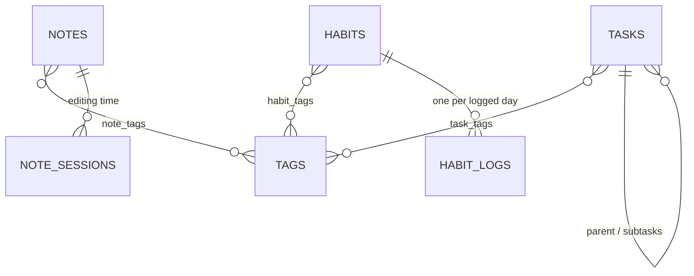

# kanso-backend

The API behind [kanso](https://kanso-web-app.vercel.app), a productivity app for tasks, notes, habits and a daily debrief. It's built with FastAPI, SQLAlchemy 2, Alembic and Postgres (hosted on Supabase), and deployed on Fly.io.

| Repository | Role |
|---|---|
| [kanso-frontend](https://github.com/LuisFVillalon/kanso-frontend) | Next.js web app (start here for the full architecture) |
| **kanso-backend** (this repo) | Data API: tasks, tags, notes, habits, profile, daily debrief, demo sandboxes |
| [kanso-ai](https://github.com/LuisFVillalon/kanso-ai) | LLM-backed learning-resource recommendations |

Interactive API reference: `/docs` on any running instance.

## Highlights

- **Auth without owning passwords.** Users sign in with Supabase Auth; every endpoint verifies the Supabase JWT (ES256/RS256 via the project's JWKS, or HS256 with the project secret) and takes the user id from the token's `sub` claim. No endpoint accepts a user id from the client.
- **Tenant isolation.** Every row carries a `user_id` and every query filters on it. Single-row lookups all go through one helper, `crud/base.py:get_owned`, so the ownership check can't be skipped in a new module.
- **Database closed to direct access.** Supabase exposes `public` tables through an auto-generated REST API. A migration enables Row Level Security and revokes the `anon`/`authenticated` grants on every table (including future ones), so the public Supabase key can't reach the data. The backend connects as the table owner and is unaffected.
- **Per-visitor demo sandboxes.** `POST /demo/seed` accepts only Supabase *anonymous* users and fills their sandbox with sample data dated relative to the visitor's local day. A background task deletes sandboxes older than a day, both their rows and their auth users.
- **Timezone-correct logic.** The server runs in UTC. Habit streaks, "due today" and the daily debrief take the caller's `local_date`/`local_time` rather than the server clock, and note time totals take the caller's UTC offset.
- **A rule-based daily debrief.** `GET /daily-debrief` combines overdue and due-today tasks, today's completions, habit status and workload capacity (committed vs. available minutes, respecting rest days) into a prioritized "focus next" list. No LLM is involved.
- **Input bounds and rate limits.** Request schemas cap field lengths and list sizes; demo seeding is rate-limited per user.

## Data model



Every table also carries `user_id`. The single-row-per-user tables are `profiles` (display name and synced UI preferences), `calendar_settings` (the term tracker) and `drawings` (the doodle canvas). Join tables and child rows cascade on delete, so removing an account is one pass over `crud/account_crud.py:USER_OWNED_MODELS`.

## Project structure

```
app/
  main.py        # App, CORS, router registration, /health
  core/          # auth.py (JWT verification), supabase_admin.py, rate_limit.py, http_utils.py
  routers/       # One per domain; thin handlers that depend on get_current_user + get_db
  crud/          # Queries and business logic (streaks, debrief, demo seed, account deletion)
  models/        # SQLAlchemy models
  schemas/       # Pydantic request/response models; limits.py holds the input bounds
  database/      # Engine and session setup (Supabase pooler / pgBouncer-safe)
tests/           # pytest suite (needs a throwaway Postgres, see below)
alembic/         # Migrations (date-prefixed); run automatically on every deploy
```

Routes use verb-style paths (`/get-tasks`, `/create-task`, `/update-task/{id}`, `/del-task/{id}`). Each domain has one file per layer: `routers/` → `crud/` → `models/` + `schemas/`.

## Endpoints

All endpoints require `Authorization: Bearer <supabase-jwt>`.

| Area | Endpoints |
|---|---|
| Tasks | `GET /get-tasks` · `POST /create-task` · `PUT /update-task/{id}` · `PATCH /update-task-status/{id}` · `PATCH /archive-task/{id}` · `PATCH /unarchive-task/{id}` · `DELETE /del-task/{id}` · `PATCH /restore-task/{id}` · `DELETE /purge-task/{id}` |
| Tags | `GET /get-tags` · `POST /create-tags` · `PUT /update-tag/{id}` · `PATCH /archive-tag/{id}` · `PATCH /unarchive-tag/{id}` · `DELETE /del-tag/{id}` · `PATCH /restore-tag/{id}` · `DELETE /purge-tag/{id}` |
| Notes | `GET /get-notes` · `POST /create-note` · `PUT /update-note/{id}` · `PATCH /archive-note/{id}` · `PATCH /unarchive-note/{id}` · `DELETE /del-note/{id}` · `PATCH /restore-note/{id}` · `DELETE /purge-note/{id}` |
| Note time | `POST /note-session/start` · `PUT /note-session/end/{id}` · `GET /note-session/total/{note_id}` · `GET /note-session/totals` · `GET /note-session/totals-range` · `POST /note-session/reap` |
| Habits | `GET /get-habits` · `POST /create-habit` · `PUT /update-habit/{id}` · `PATCH /archive-habit/{id}` · `PATCH /unarchive-habit/{id}` · `DELETE /del-habit/{id}` · `PATCH /restore-habit/{id}` · `DELETE /purge-habit/{id}` · `PATCH /toggle-habit/{id}` · `PATCH /toggle-habit-date/{id}` · `POST /verify-streaks` · `GET /habit-history/{id}` |
| Trash | `GET /get-trash?kind=` |
| Daily debrief | `GET /daily-debrief?local_date=&local_time=` |
| Calendar activity | `GET /get-calendar-activity?start_date=&end_date=&tz=` |
| Profile & settings | `GET /get-profile` · `POST /save-profile` · `GET /get-calendar-settings` · `PATCH /update-calendar-settings` |
| Doodle canvas | `GET /get-drawing` · `POST /save-drawing` · `DELETE /delete-drawing` |
| Account | `POST /update-password` (email accounts only) · `DELETE /delete-account` |
| Demo | `POST /demo/seed?local_date=` (anonymous users only) |

**Archiving.** Tasks, notes, tags and habits carry an `archived_at` timestamp (`null` while active). `GET /get-tasks`, `/get-notes`, `/get-tags` and `/get-habits` return active rows only; pass `?archived=true` to list the archived ones instead. Archiving a task also archives its subtasks, and restoring it restores the subtasks archived with it plus any archived parents above it. Archiving a tag only hides it: tasks, notes and habits keep it in their `tags` lists. Creating or updating a task or note with an archived tag it didn't already carry restores that tag. Archived tasks, notes and habits are left out of the daily debrief and note-time totals, and archived habits are skipped by `POST /verify-streaks`.

**Trash.** The `del-*` endpoints move a task, note, tag or habit to the trash by setting its `deleted_at` instead of removing the row, and work on archived rows too. A deleted item is gone from every list, lookup, count and the debrief, but its tag links, habit logs and note sessions are kept: `PATCH /restore-{kind}/{id}` brings it back intact (into the archive, if it was archived). Deleting a task also deletes its subtasks; restoring it restores the subtasks deleted with it plus any deleted parents above it. A deleted tag is hidden from the `tags` lists of the items carrying it until restored, and naming it on a task, note or habit restores it. `GET /get-trash` lists deleted items newest first (`?kind=task|note|tag|habit` for one kind), each with its `purge_at`, 30 days after deletion. `DELETE /purge-{kind}/{id}` deletes one for good right away. Items deleted more than 30 days ago are treated as gone everywhere, the trash and restore included, and are permanently deleted, for every user at once, when the app starts and whenever anyone opens the trash, restores or purges from it, or deletes something (`crud/trash_crud.py`), so no scheduler is needed.

**Calendar activity.** `GET /get-calendar-activity` returns what the user planned and did across a range of their local days (up to 366): tasks due in the range, tasks completed in it (by `completed_date`, set when a task is marked complete and cleared when it's reopened), closed note editing sessions that overlap it, and habit completions. It backs the calendar's week view and its weekly, monthly and yearly reports. Completion and session timestamps come back in UTC with a `Z` suffix; `tz`, the caller's IANA time zone (e.g. `America/Los_Angeles`, from `Intl.DateTimeFormat().resolvedOptions().timeZone`), matches them against the caller's local days, correctly across DST changes; an unknown zone is a 422. Archived tasks and notes are left out, and tasks completed before completion times were recorded have no `completed_date`, so they don't appear as completions.

`GET /health` is public and used by Fly.io health checks.

## Running locally

Requires Python 3.12+ and a Postgres database (a Supabase project works as-is).

```bash
python -m venv venv
source venv/bin/activate          # Windows: venv\Scripts\activate
pip install -r requirements.txt
# create .env (see below)
alembic upgrade head
uvicorn app.main:app --reload     # http://localhost:8000/docs
```

| Variable | Required | Description |
|---|---|---|
| `DATABASE_URL` | Yes | Postgres connection string. On Supabase, use the pooler URL (the direct `db.*` host is IPv6-only). |
| `SUPABASE_URL` | Yes | Supabase project URL, used to fetch the JWKS for token verification |
| `SUPABASE_SERVICE_ROLE_KEY` | For account & demo endpoints | Service-role key for the Supabase Admin API |
| `SUPABASE_JWT_SECRET` | Only for HS256 projects | Legacy symmetric JWT secret |
| `ALLOWED_ORIGINS` | No | Comma-separated CORS origins (default: `http://localhost:3000,https://kanso-web-app.vercel.app`) |

Linting: `ruff check .` (config in `pyproject.toml`).

Tests: `pip install -r requirements-dev.txt`, then `TEST_DATABASE_URL=postgresql://... pytest`. The tests need Postgres (the queries use Postgres-only SQL) and drop and recreate every table in that database, so point it at an empty throwaway one. Without `TEST_DATABASE_URL` the tests are skipped.

## Deployment

`fly deploy` builds the Docker image; on start the container runs `alembic upgrade head` and then uvicorn. The app runs in Fly's `iad` region (Ashburn), beside the database in AWS `us-east-1`, since each request makes several database round trips. One machine is kept warm to avoid cold starts.

Merges to `main` deploy automatically: `.github/workflows/ci-deploy.yml` runs `ruff check` and the test suite against a throwaway Postgres on every pull request and push to `main`, and on `main` runs `flyctl deploy --remote-only` only if they pass. The workflow needs a `FLY_API_TOKEN` repository secret holding a deploy token from `fly tokens create deploy`.

## Author

Luis Fernando Villalon, San Diego State University. [github.com/LuisFVillalon](https://github.com/LuisFVillalon)
