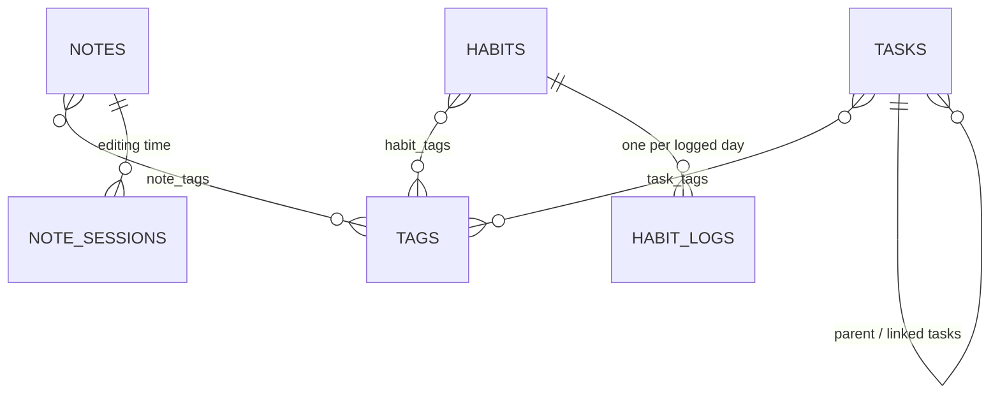

# kanso-backend

The API behind [kanso](https://kanso-web-app.vercel.app), a productivity app for tasks, notes, habits and a daily debrief. It's built with FastAPI, SQLAlchemy 2, Alembic and Postgres (hosted on Supabase), and deployed on Fly.io.

| Repository | Role |
|---|---|
| [kanso-frontend](https://github.com/LuisFVillalon/kanso-frontend) | Next.js web app (start here for the full architecture) |
| **kanso-backend** (this repo) | Data API: tasks, tags, notes, habits, mood check-ins, profile, daily debrief, notifications, Canvas LMS connection, demo sandboxes |
| [kanso-ai](https://github.com/LuisFVillalon/kanso-ai) | LLM-backed learning-resource recommendations |

Interactive API reference: `/docs` on any running instance.

## Highlights

- **Auth without owning passwords.** Users sign in with Supabase Auth; every endpoint verifies the Supabase JWT (ES256/RS256 via the project's JWKS, or HS256 with the project secret) and takes the user id from the token's `sub` claim. No endpoint accepts a user id from the client.
- **Tenant isolation.** Every row carries a `user_id` and every query filters on it. Single-row lookups all go through one helper, `crud/base.py:get_owned`, so the ownership check can't be skipped in a new module.
- **Database closed to direct access.** Supabase exposes `public` tables through an auto-generated REST API. A migration enables Row Level Security and revokes the `anon`/`authenticated` grants on every table (including future ones), so the public Supabase key can't reach the data. The backend connects as the table owner and is unaffected.
- **Per-visitor demo sandboxes.** `POST /demo/seed` accepts only Supabase *anonymous* users and fills their sandbox with sample data dated relative to the visitor's local day. A background task deletes sandboxes older than a day, both their rows and their auth users.
- **Timezone-correct logic.** The server runs in UTC. Habit streaks, "due today" and the daily debrief take the caller's `local_date`/`local_time` rather than the server clock, and note time totals take the caller's UTC offset.
- **A rule-based daily debrief.** `GET /daily-debrief` combines overdue and due-today tasks, today's completions, habit status and workload capacity (committed vs. available minutes, respecting rest days) into a prioritized "focus next" list. No LLM is involved.
- **Third-party tokens encrypted at rest.** A user's Canvas access token is stored only as AES-256-GCM ciphertext, with the key in a Fly secret rather than the database, and is never sent back to the browser.
- **Input bounds and rate limits.** Request schemas cap field lengths and list sizes; demo seeding, Canvas connect/test and Canvas data fetches are rate-limited per user.

## Data model



Every table also carries `user_id`. The single-row-per-user tables are `profiles` (display name and synced UI preferences), `calendar_settings` (the term tracker), `drawings` (the doodle canvas), `notification_preferences` and `canvas_connections` (the encrypted Canvas token); `notification_states` holds read and dismissed state per notification, and `mood_checkins` holds one mood check-in per day, week or month. Join tables and child rows cascade on delete, so removing an account is one pass over `crud/account_crud.py:USER_OWNED_MODELS`.

## Project structure

```
app/
  main.py        # App, CORS, router registration, /health
  core/          # auth.py (JWT verification), supabase_admin.py, rate_limit.py, http_utils.py,
                 # crypto.py (token encryption), canvas_client.py (Canvas API calls),
                 # canvas_cache.py (in-process cache of Canvas data)
  routers/       # One per domain; thin handlers that depend on get_current_user + get_db
  crud/          # Queries and business logic (streaks, debrief, demo seed, account deletion)
  models/        # SQLAlchemy models
  schemas/       # Pydantic request/response models; limits.py holds the input bounds
  database/      # Engine and session setup (Supabase pooler / pgBouncer-safe)
tests/           # pytest suite (needs a throwaway Postgres, see below)
alembic/         # Migrations (date-prefixed); run automatically on every deploy
```

Routes use verb-style paths (`/get-tasks`, `/create-task`, `/update-task/{id}`, `/del-task/{id}`), except the Canvas ones, which are one resource under `/canvas` with HTTP methods. Each domain has one file per layer: `routers/` → `crud/` → `models/` + `schemas/`.

## Endpoints

All endpoints require `Authorization: Bearer <supabase-jwt>`.

| Area | Endpoints |
|---|---|
| Tasks | `GET /get-tasks` · `POST /create-task` · `PUT /update-task/{id}` · `PUT /update-linked-tasks/{id}` · `PATCH /update-task-status/{id}` · `PATCH /archive-task/{id}` · `PATCH /unarchive-task/{id}` · `DELETE /del-task/{id}` · `PATCH /restore-task/{id}` · `DELETE /purge-task/{id}` |
| Tags | `GET /get-tags` · `POST /create-tags` · `PUT /update-tag/{id}` · `PATCH /archive-tag/{id}` · `PATCH /unarchive-tag/{id}` · `DELETE /del-tag/{id}` · `PATCH /restore-tag/{id}` · `DELETE /purge-tag/{id}` |
| Notes | `GET /get-notes` · `POST /create-note` · `PUT /update-note/{id}` · `PATCH /archive-note/{id}` · `PATCH /unarchive-note/{id}` · `DELETE /del-note/{id}` · `PATCH /restore-note/{id}` · `DELETE /purge-note/{id}` |
| Note time | `POST /note-session/start` · `PUT /note-session/end/{id}` · `GET /note-session/total/{note_id}` · `GET /note-session/totals` · `GET /note-session/totals-range` · `POST /note-session/reap` |
| Habits | `GET /get-habits` · `POST /create-habit` · `PUT /update-habit/{id}` · `PATCH /archive-habit/{id}` · `PATCH /unarchive-habit/{id}` · `DELETE /del-habit/{id}` · `PATCH /restore-habit/{id}` · `DELETE /purge-habit/{id}` · `PATCH /toggle-habit/{id}` · `PATCH /toggle-habit-date/{id}` · `POST /verify-streaks` · `GET /habit-history/{id}` |
| Trash | `GET /get-trash` |
| Mood check-ins | `GET /get-mood-checkins?start_date=&end_date=&kinds=` · `PUT /save-mood-checkin` · `DELETE /del-mood-checkin/{id}` · `GET /get-mood-tags` |
| Daily debrief | `GET /daily-debrief?local_date=&local_time=` |
| Calendar activity | `GET /get-calendar-activity?start_date=&end_date=&tz=&include_archived=` |
| Notifications | `GET /get-notifications?tz=` · `POST /mark-notifications-read` · `POST /mark-all-notifications-read?tz=` · `POST /dismiss-notifications` · `GET /get-notification-preferences` · `PATCH /update-notification-preferences` |
| Profile & settings | `GET /get-profile` · `POST /save-profile` · `GET /get-calendar-settings` · `PATCH /update-calendar-settings` |
| Doodle canvas | `GET /get-drawing` · `POST /save-drawing` · `DELETE /delete-drawing` |
| Canvas connection | `GET /canvas/connection` · `PUT /canvas/connection` · `POST /canvas/connection/test` · `PATCH /canvas/connection` · `DELETE /canvas/connection` (not for demo sandboxes) |
| Canvas data | `GET /canvas/overview?tz=` · `GET /canvas/courses?include_hidden=` · `GET /canvas/courses/{id}/modules` · `GET /canvas/courses/{id}/assignments` · `GET /canvas/announcements?tz=` (all take `refresh=`; sample data for demo sandboxes) |
| Account | `POST /update-password` (email accounts only) · `DELETE /delete-account` |
| Demo | `POST /demo/seed?local_date=` (anonymous users only) |

**Linked tasks.** A task can have linked tasks: tasks that lead up to completing it, stored as subtasks (`parent_task_id`). Each task has at most one parent, and links go one level deep: a linked task can't have linked tasks of its own, and a task that has them can't be linked under another. Links that would form a loop, or put a task under an archived parent, are rejected too. Every way of setting a parent (`POST /create-task`, `PUT /update-task/{id}` and the endpoint below) answers these with a 400. Only new links are checked: `PUT /update-task/{id}` checks only a changed parent and the endpoint below only tasks not already under this parent, so re-saving existing links works even in deeper trees saved before the rule. Linked tasks carry a `position` (`null` for top-level tasks) and belong under their parent in order of `position`, then `id`; a task created or moved under a parent goes last, and links made before ordering existed have a `null` position and sort after the rest.

`PUT /update-linked-tasks/{id}` saves all of a task's linked tasks in one transaction. The body lists them in order, each either an existing task or the title of a new one, up to 100: `{"children": [{"id": 12}, {"title": "Draft cover letter"}]}`. Existing tasks are linked, and moved here if they had another parent. New ones are created with the parent's tags and no due date or priority. Each gets its index as its `position`. Active linked tasks left out are unlinked, not deleted; archived ones stay linked, since the client doesn't see them. Listing an archived, deleted or missing task, or the same task twice, is a 400 and saves nothing. The response is `{"parent": Task, "children": [Task, ...]}`, children in order.

`DELETE /del-task/{id}` and `PATCH /archive-task/{id}` take `?linked=keep|cascade`, for the "delete or archive its linked tasks too?" question. `cascade`, the default (so clients that don't send it work as before), deletes or archives the task's subtasks along with it, as described under Archiving and Trash below. `keep` first unlinks the task's linked tasks, which stay as standalone top-level tasks (`parent_task_id` and `position` set to `null`), then deletes or archives the task alone: deleting unlinks every linked task not in the trash, archived ones included; archiving unlinks the active ones and leaves those archived on their own linked. An unlinked task doesn't come back under the parent when the parent is restored. Any other value is a 422.

`PATCH /update-task-status/{id}?with_linked=true` is "Complete all": when the toggle completes the task, its open linked tasks that aren't archived or deleted are completed in the same transaction, with the same `completed_date`. Reopening a task with it leaves the linked tasks as they are. Without it (the default) only the task itself is toggled.

**Archiving.** Tasks, notes, tags and habits carry an `archived_at` timestamp (`null` while active). `GET /get-tasks`, `/get-notes`, `/get-tags` and `/get-habits` return active rows only; pass `?archived=true` to list the archived ones instead. Archiving a task also archives its subtasks (unless `?linked=keep`), and restoring it restores the subtasks archived with it plus any archived parents above it. Archiving a tag only hides it: tasks, notes and habits keep it in their `tags` lists. Creating or updating a task or note with an archived tag it didn't already carry restores that tag. Archived tasks, notes and habits are left out of the daily debrief and note-time totals, and archived habits are skipped by `POST /verify-streaks`.

**Trash.** The `del-*` endpoints move a task, note, tag or habit to the trash by setting its `deleted_at` instead of removing the row, and work on archived rows too. A deleted item is gone from every list, lookup, count and the debrief, but its tag links, habit logs and note sessions are kept: `PATCH /restore-{kind}/{id}` brings it back intact (into the archive, if it was archived). Deleting a task also deletes its subtasks (unless `?linked=keep`); restoring it restores the subtasks deleted with it plus any deleted parents above it. A task whose old parent is gone for good, or has since been linked under another task, comes back as a top-level task instead. A deleted tag is hidden from the `tags` lists of the items carrying it until restored, and naming it on a task, note or habit restores it. `GET /get-trash` lists deleted items newest first, each with its `purge_at`, 30 days after deletion. `DELETE /purge-{kind}/{id}` deletes one for good right away. Items deleted more than 30 days ago are treated as gone everywhere, the trash and restore included, and are permanently deleted, for every user at once, when the app starts and whenever anyone opens the trash, restores or purges from it, or deletes something (`crud/trash_crud.py`), so no scheduler is needed.

**Calendar activity.** `GET /get-calendar-activity` returns what the user planned and did across a range of their local days (up to 366): tasks due in the range, tasks completed in it (by `completed_date`, set when a task is marked complete and cleared when it's reopened), closed note editing sessions that overlap it, and habit completions. It backs the calendar's week view and its weekly, monthly and yearly reports. Completion and session timestamps come back in UTC with a `Z` suffix; `tz`, the caller's IANA time zone (e.g. `America/Los_Angeles`, from `Intl.DateTimeFormat().resolvedOptions().timeZone`), matches them against the caller's local days, correctly across DST changes; an unknown zone is a 422. Deleted (trashed) tasks, notes and habits are always left out. Archived ones are left out too unless `include_archived=true`, meant for the reports so archived work still counts. It adds archived tasks (due and completed), the sessions of archived notes and the logs of archived habits. Tasks completed before completion times were recorded have no `completed_date`, so they don't appear as completions.

**Notifications.** In-app alerts, computed on demand from tasks, habits, mood check-ins and the profile each time `GET /get-notifications?tz=` is called, so there is no scheduler. `tz` is the caller's IANA time zone, as for calendar activity; due times, the profile's "Day starts at" (`day_start_time`, default 08:00) and "Call it a day" (`shutoff_time`, default 22:00) and quiet hours are local times in it, and every alert time follows DST. Seven types exist:

| Type | Fires | Lapses |
|---|---|---|
| `due_today` | At the day start, listing the open tasks due today | At midnight |
| `task_reminder` | `reminder_minutes` before a task's due time (the task's own, else the user's default, 120) | When the final warning fires |
| `final_warning` | 30 minutes before a task's due time | When the task is due |
| `overdue` | Once, when a task's due time passes; for a task with only a due date, at the next day start | Never (for 30 days) |
| `habit_reminder` | An hour before "Call it a day" while any of the day's habits isn't logged; not on rest days | At midnight |
| `mood_reminder` | `mood_reminder_minutes` (30 or 60, default 60) before "Call it a day" while the day's mood check-in isn't logged; not on rest days | At midnight, or at "Call it a day" if that is after midnight |
| `mood_missed` | At the day start, listing the past 7 days with no daily mood check-in; not on rest days | At midnight |

Both mood alerts need daily check-ins on in the profile's `mood_checkins` settings, and its `remind: "off"` silences them too; the `types` switches turn each one off on its own. `remind` otherwise only sets when the dashboard nudge appears, and doesn't change the `mood_reminder` lead. `mood_missed` leaves out rest days and days before the user's first daily check-in (when daily check-ins were switched on isn't stored), and drops days as they are backfilled. Neither says anything about what a check-in holds, only that one is due or missing.

Only open tasks with a `due_date` count, and reminders and final warnings also need a `due_time`; a lead of 30 minutes or less sends only the final warning. Completed, archived and deleted tasks and archived and deleted habits are left out. Each notification has `id`, `type`, `title`, `body`, `fire_at` (UTC, `Z` suffix), the `task_ids` or `habit_ids` it is about, `dates` (for the mood alerts, the local days whose check-in is due or missing, so the client can open the form for them) and `read`; the list is newest first. Ids are deterministic, `{type}:{subject}:{occurrence}` (e.g. `overdue:task-12:2026-10-20T16:00` or `due_today:tasks:2026-10-20`), so read and dismissed state, stored per id, holds across reloads and devices; moving a task's due time makes a new occurrence. `POST /mark-notifications-read` and `POST /dismiss-notifications` take `{"ids": [...]}` (up to 200); `POST /mark-all-notifications-read?tz=` marks everything currently listed. Dismissed notifications are left out of the list. Occurrences older than 30 days are no longer listed, and their state rows are deleted, for every user, at startup and whenever anyone marks or dismisses notifications.

`GET /get-notification-preferences` returns `types` (every type, `true` unless switched off), `quiet_hours_start`/`quiet_hours_end` (`"HH:MM"` or `null`), `default_reminder_minutes` and `mood_reminder_minutes`. `PATCH /update-notification-preferences` changes only the fields given: `types` merges, quiet hours are set as a pair (they may run past midnight, e.g. 22:00 to 07:00) and cleared with two `null`s, a `null` `default_reminder_minutes` restores 120, and `mood_reminder_minutes` takes 30 or 60, with `null` restoring 60. An alert that fires during quiet hours is delivered when they end, with its `fire_at` moved to then, and is dropped if it would already have lapsed. Tasks take an optional `reminder_minutes` (1 to 10080) on create and update; `null` uses the default.

**Mood check-ins.** A short end-of-day, end-of-week or end-of-month form about the user's mood, for the calendar reports. There is one check-in per user, `period_kind` (`day`, `week` or `month`) and `period_start`, the caller's local date: the day itself, the Monday of a Mon–Sun week, or the 1st of the month. Every check-in has a `mood` from 1 (Rough) to 5 (Great), an optional `note` (up to 280 characters) and `tags`; the other fields depend on the kind:

| Kind | Fields |
|---|---|
| `day` | `energy` (1 Drained to 5 Charged) · `stress` (1 Calm to 5 Maxed) |
| `week` | `workload` (0 too light, 1 about right, 2 too much) · `highlight` (the best part of the week, up to 120 characters) |
| `month` | `progress` (on what matters, 1 none to 5 a lot) · `word` (the month in one word, up to 24 characters) |

`PUT /save-mood-checkin` creates the period's check-in or replaces it in place (same `id`), so editing and backfilling are the same call; it takes the whole form, so a field left out is cleared. A field from another kind, a week not starting on a Monday, a month not starting on the 1st, or a `period_start` more than a day past the server's UTC date is a 422. `GET /get-mood-checkins` returns the check-ins whose `period_start` falls in a range of up to 366 days, oldest first, optionally only the `kinds` given (comma-separated, e.g. `day,week`). `DELETE /del-mood-checkin/{id}` deletes one for good, with no trash, and returns it so the client's Undo can save it again. Mood tags are a list of their own, separate from task tags: each check-in carries up to 20, trimmed and de-duplicated ignoring case, and `GET /get-mood-tags` returns the default list (`Slept well`, `Exercised`, …) plus the custom tags the user has used, most recent first. Correlations with tasks, note time and habits are left to the frontend, which joins these rows with `/get-calendar-activity`. Mood data stays out of the daily debrief and every AI feature.

The profile's `home_panels` is the pair of home-page panels shown side by side, left then right, from the Tasks → Notes → Canvas ring: `tasks,notes`, `notes,canvas` or `canvas,tasks`. It is `null` until set (the frontend's default), `POST /save-profile` rejects any other value with 422, and demo users save it like any other profile preference.

The profile's `mood_checkins` settings say which check-ins the dashboard nudges for (`daily`, and `remind` when `off`, also switch off the `mood_reminder` and `mood_missed` notifications): `daily` (default on), `weekly` and `monthly` (default off), `remind` (`shutoff`, `shutoff+30` or `off`, default `shutoff`, i.e. at "Call it a day") and `show_in_reports` (default on). `GET /get-profile` returns them with defaults filled in; `POST /save-profile` merges the fields given into the saved ones, a `null` field restores its default and a `null` `mood_checkins` restores them all. The demo sandbox comes with about 60 days of check-ins.

**Canvas.** A user connects their school's Canvas LMS with a personal access token (Canvas → Account → Settings → New access token) and the school's Canvas address. `PUT /canvas/connection` takes `{"base_url", "token"}`: the address may be a bare host or any page URL on it and is reduced to `https://host`; it must be https on a public DNS name, with no IP literal, custom port or credentials, and every address it resolves to must be public, since the server calls it. The name is resolved once per check and requests go only to the addresses that passed, with TLS verified for the school's host name, so a DNS answer that later changes to a private address is never reached; Canvas answers over 5 MB or slower than 20 seconds in total are abandoned. The token is checked with Canvas (`GET /users/self`) before anything is stored, so a failed connect or replace leaves the current connection as it was; its expiry is read from Canvas's list of the user's tokens when Canvas allows it. The token is then encrypted with AES-256-GCM, bound to the user's id, and stored in `canvas_connections`; it is decrypted only to call Canvas and is never returned. `GET /canvas/connection` returns the masked status: `connected`, `status`, `base_url`, `token_last4` (for "Connected · ends in …xxxx"), the Canvas account's id and name, `token_expires_at`, `hidden_course_ids` and timestamps. `status` is `active`, `invalid` (Canvas rejected the token, or it is past its expiry date: show "Reconnect Canvas") or `error` (Canvas couldn't be reached on the last test). `POST /canvas/connection/test` re-checks the token and returns the updated status; an expired token is marked invalid without calling Canvas. The same `PUT` replaces or reconnects; a token for a different Canvas account or school is refused with 409 unless the body adds `"allow_account_change": true`, which also resets `hidden_course_ids`. `PATCH /canvas/connection` takes `{"hidden_course_ids": [...]}` (the courses unticked under "Courses to show", up to 500). `DELETE /canvas/connection` deletes the row and token for good, with no trash; account deletion and the demo reset remove it too. Demo sandboxes get 403 on every connection route. Connect and test are limited to 10 calls a minute per user. Canvas failures return a code as the `detail`: `canvas_url_invalid`, `canvas_not_canvas` (the host didn't answer like Canvas), `canvas_token_invalid`, `canvas_forbidden` (422), `canvas_account_changed` (409), `canvas_unavailable` (502: Canvas down, slow or rate-limiting), `canvas_not_connected` (404) and `canvas_not_configured` (503: the server has no `CANVAS_TOKEN_KEY`).

**Canvas data.** The home page's Canvas panel reads through five routes, each a proxy to the school's Canvas with the stored token, returning trimmed shapes rather than raw Canvas JSON. `GET /canvas/overview?tz=` returns `upcoming`, the planner's assignments, quizzes, discussions, pages, events and notes due from the start of the caller's local today through 7 days later (`start` and `end` give the window; `tz` is an IANA zone, default UTC), soonest first, `missing`, Canvas's missing submissions for the current grading period, and `recently_graded`, the planner's graded items due in the 7 days before `start`, newest first, at most 10 (from the same planner request, widened back 7 days). Each item has `id`, `kind` (`assignment`, `quiz`, `discussion`, `page`, `event`, `note` or `other`), `title`, `course_id`, `course_name`, `due_at`, `points_possible`, `html_url` and `submission` (`submitted`, `missing`, `late`, `graded`, `excused`, plus `score`, `grade`, `submitted_at` and `graded_at` where Canvas gives them). `GET /canvas/courses` lists active courses with `course_code`, `term`, the current score and grade, and the current grading period's; a course whose instructor hides the total has `grades_hidden: true` and no scores ("Hidden by instructor"). `GET /canvas/courses/{id}/modules` returns the course's modules in order with `state` (`locked`, `unlocked`, `started` or `completed`), `unlock_at` and items, each with its `type`, whether it is `locked`, its due date and its completion `requirement`; the items of long modules, which Canvas leaves out, are fetched for up to 10 modules, and `items_complete` is false on the rest. `GET /canvas/courses/{id}/assignments` lists the course's assignments by due date with the user's submission; quizzes are assignments with `kind: "quiz"` (and `quiz_id` for classic quizzes). `GET /canvas/announcements?tz=` returns the last 14 days of announcements from the user's courses, newest first, with the HTML reduced to plain text (up to 2,000 characters), the author and `read`. Every `html_url` is an https link on the school's Canvas host, or `null`.

Courses unticked under "Courses to show" (`hidden_course_ids`) are left out of every route; `GET /canvas/courses?include_hidden=true` lists them too, with `hidden: true`, for Settings, and a hidden course's modules or assignments are a 404 `canvas_course_hidden` without calling Canvas. Lists are paginated by following Canvas's `Link` header, only while it stays on the school's Canvas API, for up to 10 pages. Responses are cached in memory per user: overview and announcements for 5 minutes, courses and assignments for 15, modules for 30. Every response carries `fetched_at` (for "Synced 3 min ago"), `busy`, `stale` and `sample`. `refresh=true` fetches again unless the cached copy is under 30 seconds old. When Canvas rate-limits the token (429, or 403 "Rate Limit Exceeded"), the backend waits about 1, 2 and 4 seconds between retries, then serves the cached data with `busy: true` and `stale: true`, or returns 502 `canvas_busy` (with `Retry-After`) if nothing is cached; if Canvas is down it serves the cache with `stale: true`, or 502 `canvas_unavailable`. A 401 from Canvas marks the connection `invalid` and drops its cached data. From then on, as for a token past its expiry date, the routes answer 409 `canvas_token_invalid` ("Reconnect Canvas") without calling Canvas until the user reconnects. A 401 that only says the user may not see something (e.g. a course's Modules tab is hidden) is 422 `canvas_forbidden` and leaves the connection alone. An unknown course is 404 `canvas_course_not_found` (a 404 from Canvas on a route without a course is 422 `canvas_not_canvas`), and no connection is 404 `canvas_not_connected`. Fetches that reach Canvas are limited to 30 a minute per user, two at a time; past the limit the cached data is served with `stale: true`, or 429 if there is none, and a fetch that waits over 25 seconds for its turn is treated as Canvas being down. Replacing or removing the token clears the cache; a fetch still running with the old token neither caches its result nor marks the new connection invalid, and a 401 it gets is retried once against the current connection (404 `canvas_not_connected` if it was removed). Demo sandboxes get fixed read-only sample data from these routes, a made-up SDSU Fall 2026 term with dates relative to their local day, with `sample: true` and no Canvas call.

`GET /health` is public and used by Fly.io health checks.

## Running locally

Requires Python 3.12+ and a Postgres database (a Supabase project works as-is).

```bash
python -m venv venv
source venv/bin/activate          # Windows: venv\Scripts\activate
pip install -r requirements.txt
# create .env (see below)
alembic upgrade head
uvicorn app.main:app --reload     # http://localhost:8000/docs
```

| Variable | Required | Description |
|---|---|---|
| `DATABASE_URL` | Yes | Postgres connection string. On Supabase, use the pooler URL (the direct `db.*` host is IPv6-only). |
| `SUPABASE_URL` | Yes | Supabase project URL, used to fetch the JWKS for token verification |
| `SUPABASE_SERVICE_ROLE_KEY` | For account & demo endpoints | Service-role key for the Supabase Admin API |
| `SUPABASE_JWT_SECRET` | Only for HS256 projects | Legacy symmetric JWT secret |
| `CANVAS_TOKEN_KEY` | For the Canvas endpoints | 32 random bytes, base64-encoded, that encrypt stored Canvas tokens. Generate one with `python -c "import base64, os; print(base64.b64encode(os.urandom(32)).decode())"` and set it with `fly secrets set CANVAS_TOKEN_KEY=<key>`. Without it the app starts with a warning and the Canvas endpoints return 503. Losing or changing it makes stored tokens undecryptable, so users would have to reconnect. To rotate, set `CANVAS_TOKEN_KEY_V2` (then `_V3`, ...): new tokens use the highest version and older keys keep decrypting until every row is re-encrypted. |
| `ALLOWED_ORIGINS` | No | Comma-separated CORS origins (default: `http://localhost:3000,https://kanso-web-app.vercel.app`) |

Linting: `ruff check .` (config in `pyproject.toml`).

Tests: `pip install -r requirements-dev.txt`, then `TEST_DATABASE_URL=postgresql://... pytest`. The tests need Postgres (the queries use Postgres-only SQL) and drop and recreate every table in that database, so point it at an empty throwaway one. Without `TEST_DATABASE_URL` the tests are skipped.

## Deployment

`fly deploy` builds the Docker image; on start the container runs `alembic upgrade head` and then uvicorn. The app runs in Fly's `iad` region (Ashburn), beside the database in AWS `us-east-1`, since each request makes several database round trips. One machine is kept warm to avoid cold starts.

Merges to `main` deploy automatically: `.github/workflows/ci-deploy.yml` runs `ruff check` and the test suite against a throwaway Postgres on every pull request and push to `main`, and on `main` runs `flyctl deploy --remote-only` only if they pass. The workflow needs a `FLY_API_TOKEN` repository secret holding a deploy token from `fly tokens create deploy`.

## Author

Luis Fernando Villalon, San Diego State University. [github.com/LuisFVillalon](https://github.com/LuisFVillalon)
